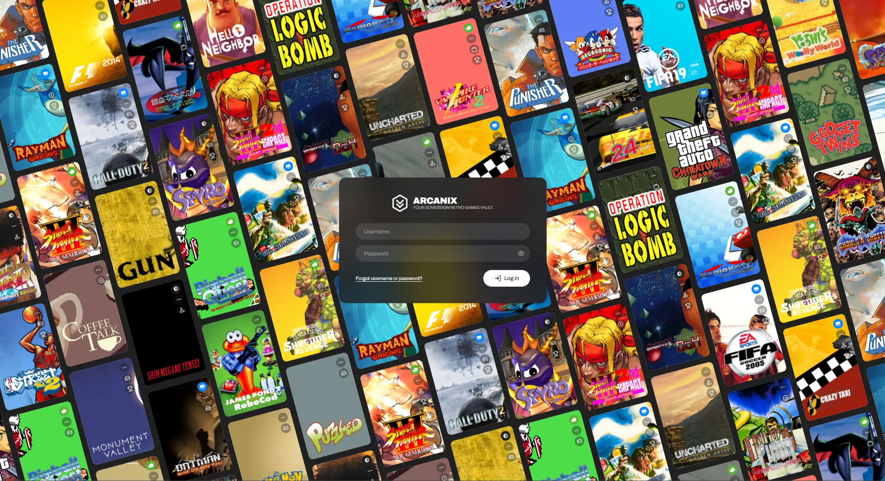

<picture>
  <source media="(prefers-color-scheme: dark)" srcset="images/arcanix-logo-white.png">
  <source media="(prefers-color-scheme: light)" srcset="images/arcanix-logo-black.png">
  
</picture>

&nbsp;

 

&nbsp;

> [!CAUTION]
> *Arcanix was built entirely by vibe coding with **Claude Code**. I described what I wanted, step by step, and the AI wrote the code. I tested every part on my own PC, Android and handhelds and use it every day. A lot of care went into making it careful with your files. It never deletes a game file on its own, never overwrites your edits or saves by surprise, and always tells you plainly when something goes wrong.*
>
> *Still, it's a hobby project, provided **as is**, without any warranty. **Use it at your own risk**, and keep a backup of anything you can't afford to lose, like your games and saves.*

Arcanix is a ROM manager for your retro games that works the same on all your devices. It runs on a Windows PC, **the host**, and three small apps connect to it: **Arcanix Mini** (Android), **Mini Knulli** and **Mini Onion** (handhelds).

📖 **[How to use Arcanix: every module, step by step](GUIDE.md)**

---

## 📚 Library
Point it at your games folder once. Every new, deleted or renamed game shows up by itself.

## 🖼️ Scraping
Fills every game with its description, a big background picture and a clean logo. It never overwrites your own edits.

## 🏆 RetroAchievements
Your profile, your recent games, your progress and the Achievement of the Week, right in your library.

## 🎨 Appearance
Build your own home page: a slideshow on top and as many rows of games as you like.

## 🔄 Syncer
Keeps your games the same on the host and the Android. Missing games are copied over by themselves. Deleting a game by hand never deletes it on another device: only the **Delete Game** button, set to All devices, deletes it everywhere.

## 📁 Saver
Shares any folder (screenshots, BIOS, configs) between your devices and keeps it exactly the same on all of them.

## 💾 Archer
Your game saves follow you. Save on a handheld, continue on the Android.

## 🌍 Connectivity
Reach your library from anywhere in the world, through your own small server. Your games stay at home.

## 🔒 Privacy and safety
Encrypted data, secure connections, and nothing left behind on any device.

---

## 📥 Getting started

1. Download the files from the [Releases](https://github.com/spoonksss/Arcanix/releases) page.
2. **On the PC:** run `Arcanix-Setup-<version>.exe`, create your account and choose your games folder.
3. **On Android:** install `Arcanix-Mini-<version>.apk`.
4. **On Knulli:** unzip `Mini-Knulli-<version>.zip` onto the root of the games partition, the one with the roms and system folders.
5. **On Onion OS:** unzip `Mini-Onion-<version>.zip` onto the root of the SD card.
6. **Arcanix Mini:** log in with your Arcanix account. **Handhelds:** open Mini Knulli from Ports or Mini Onion from Apps, and approve its request in the host's window.

---

## 🛠️ Under the hood

- **The host:** a Python backend and a React + Vite frontend. The frontend follows its own design system, and every build is checked so no screen strays from it.
- **Arcanix Mini:** a native Android app.
- **Mini Onion and Mini Knulli:** small native C programs with their own secure connection code, made to run on low-power handhelds.

---

## 📜 License

Arcanix, Copyright (C) 2026 Dimitar Tsonov. Licensed under GNU GPLv3.

You're free to use, change, rebuild and share Arcanix. If you share a changed version, its code must be shared too, under the same license. See [LICENSE](LICENSE).

Parts made by others, like the Archivo font, keep their own licenses.

---

